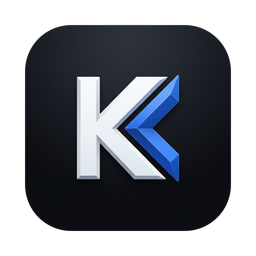
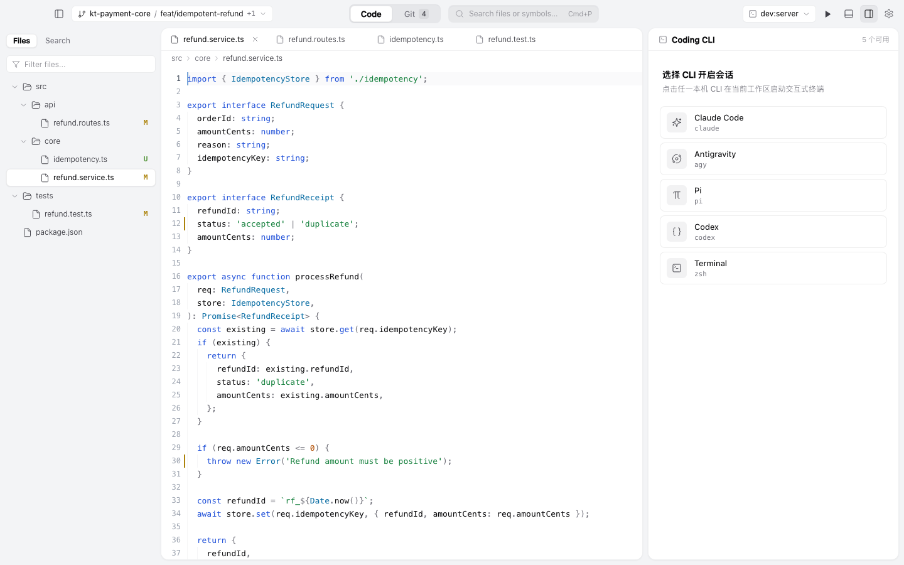
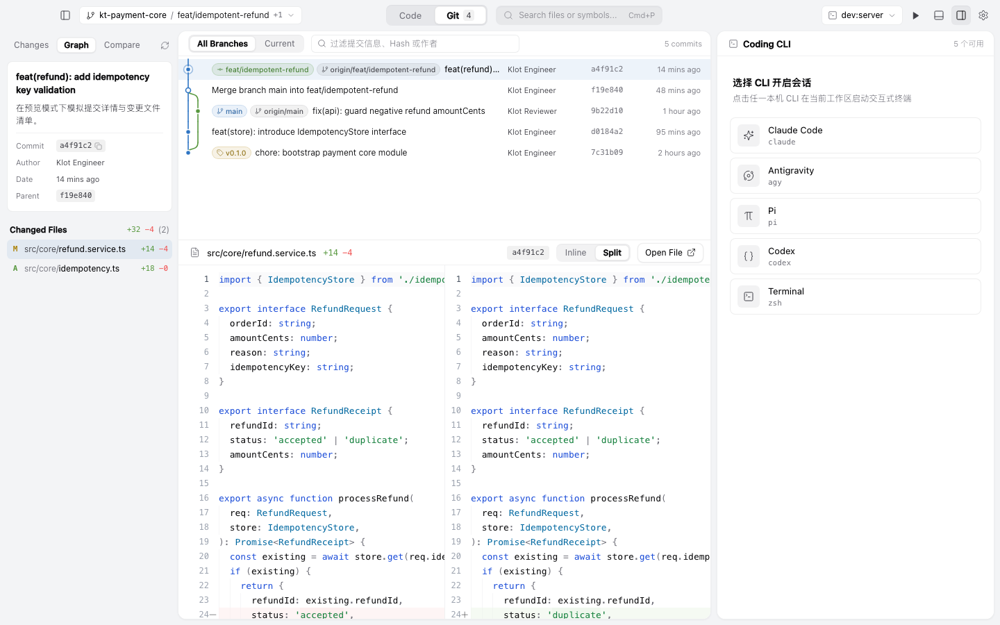
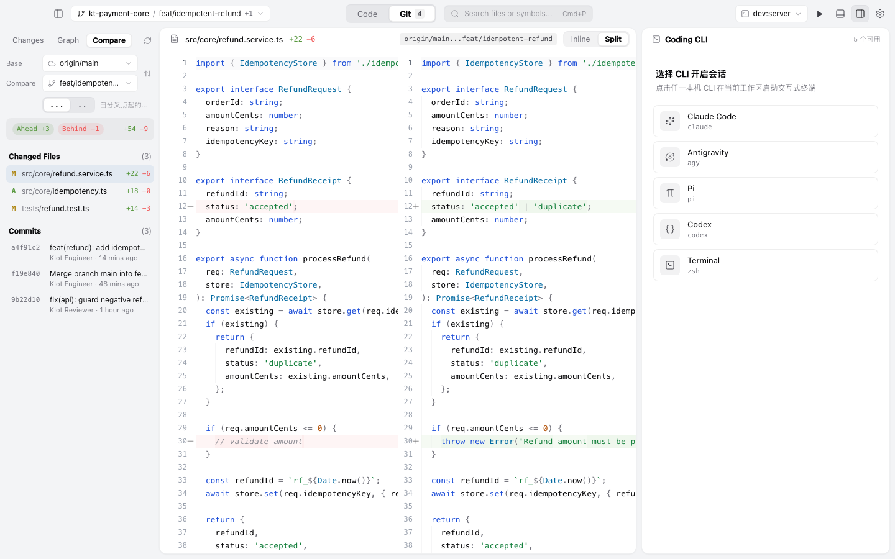

<div align="center">
  
  <h1>Klot IDE</h1>
  <p>面向 macOS 本地研发与终端编码代理协同的轻量级原生集成开发环境</p>
  <p>
    
    
    
    
    
  </p>
  <p>
    <a href="#项目简介">项目简介</a> |
    <a href="#界面预览">界面预览</a> |
    <a href="#核心特性">核心特性</a> |
    <a href="#系统架构">系统架构</a> |
    <a href="#快速开始">快速开始</a> |
    <a href="#快捷键参考">快捷键参考</a> |
    <a href="#插件扩展与延伸文档">插件扩展与延伸文档</a> |
    <a href="#开源许可">开源许可</a>
  </p>
</div>

---

## 项目简介

随着 `Claude Code`、`Antigravity`、`Pi`、`Codex` 等本地 Coding CLI 工具逐渐成为日常编码的核心入口，开发者往往不再需要动辄数百兆、充斥冗余面板的传统重型 IDE，但仍需要一个冷启动迅速、界面克制且工程能力扎实的桌面工作台——用来高效翻阅多文件、审阅 Git 分叉与 Diff 变更、管理本地开发服务进程，并与右侧终端里的编码代理实时联动。

**Klot IDE**（简称 **KE**）正是为此设计的轻量级原生桌面集成开发环境：基于 **Tauri v2** 与 **Rust** 原生系统后端构建，前端采用 **React + TypeScript + Monaco Editor + xterm.js** 渲染，以 Onyx Light / Onyx Dark 双套护眼配色与三栏可拖拽纯白卡片布局，让代码编辑、Git 审查与本地 Coding CLI 在同一工作台内自然协同。

## 界面预览

### Code 编辑工作台与 Coding CLI 启动器



### Git 拓扑树与分支差异对比

| Git 拓扑树（Graph）与提交 Diff | 本地与远端分支差异对比（Compare） |
| :---: | :---: |
|  |  |

## 核心特性

### 1. 代码浏览、检索与编辑

- 嵌入微软原版 **Monaco Editor**，提供轻量高对比度日间语法配色、单行多标签切换、面包屑导航与隐藏式 Minimap，专注横向阅读体验。
- 基于 `ignore` crate 构建高速目录树，自动遵循 `.gitignore` 并过滤 `.git`、`node_modules`、`target`、`dist` 等目录；通过 `notify-debouncer-mini` 实时监听磁盘与 `.git` 元数据改动，外部或 CLI 改码后无感刷新。
- 内嵌 `ripgrep` 核心搜索引擎（`grep-searcher` + `grep-regex`），支持大小写敏感、正则表达式与全库流式检索及安全替换。
- 支持 `Cmd+P` 全局快速跳转文件、符号（`@`）与命令（`>`），并按文件语言懒启动本机 LSP（TypeScript/JavaScript、Rust、Python、Go），缺省语言服务时优雅降级。

### 2. Git 三视图工作台

- 顶栏 `[ Code | Git ]` 一键切换，在编辑器行号旁实时显示 2px 行级变更指示条（Gutter）。
- **Changes**：提供暂存、取消暂存、丢弃改动、提交说明输入与提交操作，支持 Monaco `Inline | Split` 双栏 Diff 审查。
- **Graph**：支持全分支或当前分支拓扑浏览，展示多轨道分叉与合并连线、`HEAD` / 本地分支 / 远端分支 / Tag 内联徽章、完整提交详情及单文件历史 Diff。
- **Compare**：支持任意本地分支、远端分支、Tag 与当前工作区（`WORKTREE`）间的 `...` / `..` 差异对比，并提供一键 `Fetch` 远端同步与未启用 Git 目录一键 `git init` 初始化（完整兼容 0-commit 初生仓库）。

### 3. Coding CLI 启动器与多会话 PTY 舱

- 启动时零后台进程驻留，右侧展示简洁的 `Coding CLI` 启动器首页，按需点击启动本机 `Claude Code`（`claude`）、`Antigravity`（`agy`）、`Pi`（`pi`）、`Codex`（`codex`）或交互式登录 `Terminal`（`zsh`）。
- 基于 `portable-pty` 与 `tauri::ipc::Channel<Vec<u8>>` 直推字节流到 `@xterm/xterm`，按当前界面亮/暗色主题自动注入 `COLORFGBG` 信号。
- 支持编辑器 `Cmd+L` 将选中代码行包装为 `@file#Lstart-end` 上下文芯片投喂给 CLI，并支持在终端输出中点击文件路径直接跳回左侧编辑器对应行。

### 4. 进程组级项目运行控制台

- 自动扫描工作区根目录 `package.json`、`Cargo.toml`、`Makefile` 与 `.ke/tasks.json` 发现可执行任务，也支持运行自定义命令。
- 控制台仅在中间代码画布底部按需展开，保持左侧栏与右侧 CLI 舱 100% 全高；自动高亮错误堆栈与本地监听地址。
- 启动任务时建立独立 Unix 进程组（`process_group(0)`），停止或重启时通过 `killpg`（`SIGTERM` + 超时补 `SIGKILL`）彻底回收子进程树，避免端口残留。

### 5. 自生长本地 CLI 插件引擎与自由拖拽布局

- 实时监听全局目录 `~/.ke/plugins/` 与项目目录 `<workspace>/.ke/plugins/`，保存后毫秒级热重载，无需重启 IDE。
- 启动时自动在 `~/.ke/plugins/SPEC.md` 维护中文插件协议规范，并在每个 PTY 会话中注入 `KE_PLUGINS_DIR`、`KE_WORKSPACE`、`KE_ACTIVE_FILE` 环境变量，方便在右侧直接让 Coding CLI 编写并热生效插件。
- 支持左栏宽度、右侧 CLI 舱宽度与底部运行控制台高度自由拖拽调整并本地持久化，双击分隔条即可恢复默认尺寸。

## 系统架构

Klot IDE 采用前后端严格分离设计，全部 IPC 命令与事件类型以 `./src/types/ipc.ts` 与 `./src/lib/ipcClient.ts` 为契约基准（共 41 个 Tauri Command 与 3 类推送事件），并在非 Tauri 浏览器环境下提供优雅降级 Mock。

| 层级 / 模块 | 文件位置 | 核心职责 |
| --- | --- | --- |
| 前端界面与状态层 | `src/components/`、`src/stores/` | React + Zustand 状态管理、Monaco Editor / DiffEditor、xterm.js 多会话终端、三栏拖拽布局 |
| IPC 契约与客户端 | `src/types/ipc.ts`、`src/lib/ipcClient.ts` | 41 个前后端命令类型定义、`invoke`/`Channel`/`listen` 封装与浏览器预览 Mock |
| 环境与上下文同步 | `src-tauri/src/env_path.rs` | 登录 Shell `env -0` 同步、常用开发路径与 CLI 探测、命令行目录参数解析 |
| 目录树与文件监听 | `src-tauri/src/fs_tree.rs` | `ignore` 快速扫树、文件读写创建重命名删除、`notify` 防抖广播 `fs:changed` |
| 全库搜索与替换 | `src-tauri/src/search.rs` | 内嵌 `ripgrep` 流式检索（`Channel`）与正则/大小写全库替换 |
| Git 工作台后端 | `src-tauri/src/git_ops.rs` | 异步调用本机 `git` CLI，支撑状态、初生仓库初始化、拓扑树、提交详情与跨分支 Diff |
| 任务运行器 | `src-tauri/src/task_runner.rs` | 自动发现脚本任务、流式输出日志与进程组级 `killpg` 停止/重启 |
| 本地 PTY 终端舱 | `src-tauri/src/pty_dock.rs` | `portable-pty` 多会话管理、高频字节流通道、环境变量与上下文注入 |
| 按需 LSP 桥接 | `src-tauri/src/lsp_bridge.rs` | 懒启动本机语言服务器、`Content-Length` JSON-RPC 帧收发与 `lsp:diagnostics` 转发 |
| 自生长插件宿主 | `src-tauri/src/plugin_host.rs` | 生成 `~/.ke/plugins/SPEC.md`、监听目录热更新 `plugins:updated`、stdin/stdout JSON 执行 |

### 仓库目录结构

```text
klot-ide/
├── antigravity-design-system/  # Onyx Light / Dark 设计系统 Token 与 CSS 变量
├── docs/
│   ├── PLUGIN-GUIDE.md         # 自生长插件开发实战指南
│   └── screenshots/            # 界面预览截图
├── scripts/
│   ├── apply-icon.mjs          # macOS 超椭圆圆角图标生成与替换工具
│   ├── generate-onyx-theme.mjs # 从 tokens.json 生成 Monaco 与 xterm 主题配置
│   ├── ke                      # macOS 命令行快速打开项目脚本
│   └── ke-plugin-tool.mjs      # 插件脚手架生成与协议校验 CLI
├── src/                        # React + TypeScript + Tailwind v4 前端渲染层
│   ├── components/             # 顶栏、边栏、编辑器、Git 工作台、CLI 舱与弹窗组件
│   ├── lib/                    # Tauri IPC 客户端与浏览器预览 Mock
│   ├── stores/                 # Zustand 业务状态仓库
│   ├── styles/                 # 主题样式与生成主题文件
│   └── types/                  # 前后端共享 IPC 类型契约
├── src-tauri/                  # Rust + Tauri v2 原生系统后端
│   ├── capabilities/           # Tauri v2 窗口与事件安全权限配置
│   ├── icons/                  # 桌面应用多尺寸图标与 .icns / .ico
│   ├── src/                    # 八大核心原生模块与命令注册入口
│   ├── Cargo.toml
│   └── tauri.conf.json
└── .ke/plugins/                # 开箱即用的内置自生长示例插件
```

## 快速开始

### 环境要求

- **操作系统**：macOS（Apple Silicon / Intel）
- **Node.js**：`>= 20`（含 `npm`）
- **Rust 工具链**：`rustc` 与 `cargo`（可通过 `rustup` 安装至 `~/.cargo/bin`）
- **本地 CLI（可选，按需使用）**：`git`、`claude`、`agy`、`pi`、`codex` 等

### 安装与开发调试

```bash
# 1. 克隆仓库并安装前端依赖
git clone https://github.com/Felixovo06/klot-ide.git
cd klot-ide
npm install

# 2. 根据 tokens.json 生成 Monaco 与 xterm 主题文件
npm run theme:generate

# 3. 仅启动 Vite 前端开发预览（端口 1420，自动启用浏览器 Mock）
npm run dev

# 4. 启动完整 Tauri v2 桌面端开发窗口
export PATH="$HOME/.cargo/bin:$PATH"
npm run tauri dev
```

### 类型检查与后端测试

```bash
# 前端 TypeScript 类型检查与生产构建
npx tsc --noEmit
npm run build

# Rust 后端静态检查与集成单元测试
export PATH="$HOME/.cargo/bin:$PATH"
cargo check --manifest-path src-tauri/Cargo.toml
cargo test --manifest-path src-tauri/Cargo.toml
```

### 打包 macOS 桌面应用

```bash
export PATH="$HOME/.cargo/bin:$PATH"
npx tauri build --bundles app
```

打包完成后，原生应用包位于 `src-tauri/target/release/bundle/macos/Klot IDE.app`。

### 命令行启动器配置

将 `./scripts/ke` 软链接到 `PATH` 中的目录（例如 `~/.local/bin/ke`），即可在任意项目终端直接打开 Klot IDE：

```bash
mkdir -p ~/.local/bin
ln -sf "$(pwd)/scripts/ke" ~/.local/bin/ke

# 在当前目录或指定仓库目录拉起 Klot IDE
ke .
ke /path/to/your-repo
```

### 自定义应用图标

准备一张 `1024x1024` 源图后，可通过内置脚本自动裁切 macOS 超椭圆圆角蒙版并生成 `src-tauri/icons/` 全套图标：

```bash
npm run icon:apply -- /path/to/icon.png
# 如源图自带外框，可通过 --crop 指定内缩裁切像素，例如 --crop 68
npm run icon:apply -- /path/to/icon.png --crop 68
```

## 快捷键参考

在非 macOS 平台上，`Cmd` 键自动映射为 `Ctrl`。

| 快捷键 | 功能说明 |
| --- | --- |
| `Cmd+P` | 快速跳转文件 / `@` 符号 / `>` 命令 |
| `Cmd+Shift+P` | 打开命令面板 |
| `Cmd+1` | 切换到 Code 编辑模式 |
| `Cmd+2` | 切换到 Git 审查与对比模式 |
| `Cmd+B` | 显示 / 隐藏左侧边栏 |
| `Cmd+J` | 显示 / 隐藏右侧 Coding CLI 舱 |
| `Cmd+\`` | 显示 / 隐藏底部运行控制台 |
| `Cmd+Shift+F` | 聚焦全库文本搜索面板 |
| `Cmd+S` | 保存当前打开的文件 |
| `Cmd+L` | 将当前代码选区作为上下文芯片发送到 CLI |
| `Cmd+,` | 打开应用设置弹窗 |
| `Cmd+Shift+X` | 打开扩展与插件管理弹窗 |
| `Esc` | 关闭当前激活的弹窗或面板 |

## 插件扩展与延伸文档

Klot IDE 支持 `command`（齿轮菜单 / 命令面板 / 快捷键）、`topbar_status`（顶栏微胶囊状态）与 `drawer_view`（底部结构化 Markdown 或表格报告）三种插件槽位，通过标准输入/输出 JSON 与工作台交互。仓库 `.ke/plugins/` 已内置 6 款开箱即用插件：

| 插件 ID | 槽位类型 | 功能说明 |
| --- | --- | --- |
| `git-review-to-cli` | `command` | 读取当前分支 `git diff --stat` 并生成审查请求投喂到右侧 CLI |
| `commit-craft` | `command` | 汇总工作区变更摘要并辅助生成规范化的中文提交说明 |
| `todo-audit` | `drawer_view` | 扫描工作区源码中的 `TODO` / `FIXME` 标记并在底部面板展示表格报告 |
| `code-hotspot` | `drawer_view` | 统计近 30 次提交高频修改文件与源码体积排行 |
| `port-radar` | `topbar_status` | 定时检测本地常用开发端口监听状态并在顶栏展示状态胶囊 |
| `env-doctor` | `drawer_view` | 诊断本机研发工具链（Node、Rust、Git、Coding CLI 等）与环境变量就绪状态 |

使用内置插件工具可一键创建或校验工作区插件：

```bash
node scripts/ke-plugin-tool.mjs new my-plugin
node scripts/ke-plugin-tool.mjs validate
```

延伸阅读：

- 插件开发与自举实践指南：[./docs/PLUGIN-GUIDE.md](./docs/PLUGIN-GUIDE.md)
- 工程架构详细设计：[./RUST-ARCHITECTURE-SPEC.md](./RUST-ARCHITECTURE-SPEC.md)
- 界面布局与设计 Token 规范：[./IDE-PAGE-DESIGN.md](./IDE-PAGE-DESIGN.md)

## 开源许可

本项目基于 [MIT License](./LICENSE) 开源。
